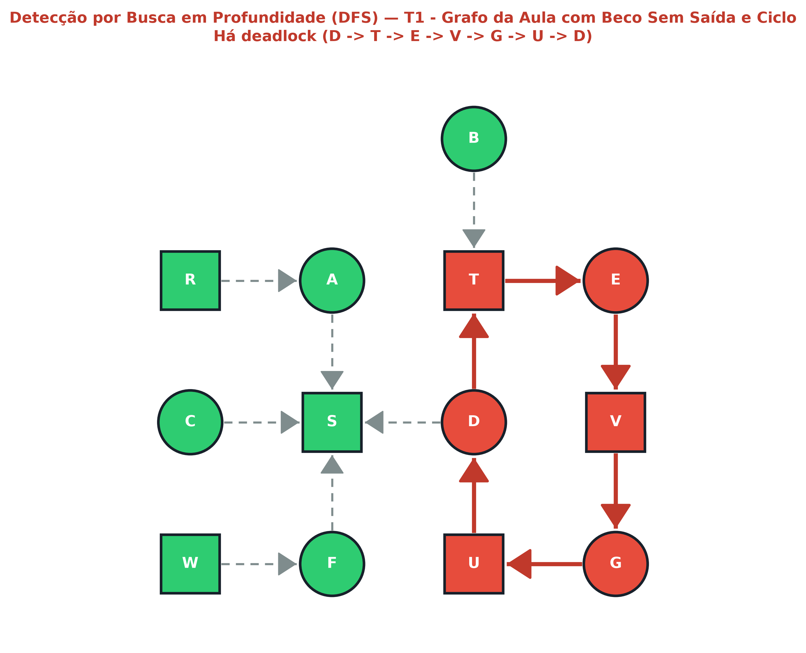

<!-- ----------------------------------------------------------------------
     [PASSO 6.1 | FASE 6 | branch: fase-6/pamella-readme | commit e push: Pamella Roberta]
     Reescreve o README da versão antiga (arquivo único) para a arquitetura modular final.
     ---------------------------------------------------------------------- -->
# Detector de Impasses (*Deadlock*) com Grafo de Alocação de Recursos via Busca em Profundidade (*DFS*)
 
**Universidade Federal do Pará (UFPA)** — *Campus* Universitário de Tucuruí (CAMTUC)  
**Faculdade de Engenharia de Computação (FECOMP)**  
**Disciplina:** Sistemas Operacionais — **Docente:** Prof. Dr. Iago Medeiros  
**Tema:** Trabalho 2 — Detector de *Deadlock* com Grafo de Alocação de Recursos (*Resource Allocation Graph* — *RAG*) com 1 recurso de cada tipo, por Busca em Profundidade (*DFS*)
 
O programa lê um grafo de alocação de recursos, procura ciclos com o algoritmo de busca em profundidade da Aula 07 (lista *L*, arcos marcados e retrocesso em beco sem saída) e responde `Há deadlock (...)`, com o ciclo encontrado, ou `Sem deadlock`. Para cada caso, também gera três imagens: um cartão com o diagnóstico, o grafo como foi lido e o grafo com o impasse destacado.
 
**Linguagem:** Python 3 (3.9 ou superior), com Matplotlib para as imagens e Jupyter para o relatório interativo.
 
---
 
## 1. Integrantes da Equipe e Divisão Modular de Responsabilidades
 
O projeto foi dividido em **6 etapas modulares**, uma por integrante, mais a integração. Cada etapa tem um arquivo próprio em `src/`, foi desenvolvida numa *branch* própria e entrou na `main` por um *Pull Request* revisado:
 
| Etapa | Integrante | Módulo no repositório | Responsabilidade técnica |
| :---: | :--- | :--- | :--- |
| **Etapa 1** | **Pamella Roberta Ferreira da Silva** | `src/etapa1_infra_e_estilo_visual_pamella.py` | **Infraestrutura e desenho:** estrutura do repositório, `requirements.txt` e `.gitignore`; resolução portável das pastas (`obter_caminhos_portaveis_repositorio()`); paleta de cores e constante única de resolução `DPI_FIGURAS`; recorte e ponta das setas (`desenhar_aresta_estilizada()`); as três imagens de cada caso — `salvar_grafo_alocacao()`, `salvar_grafo_deteccao_dfs()` e `salvar_cartao_diagnostico()` — com a explicação do resultado montada a partir do próprio grafo em `descrever_diagnostico()`. |
| **Etapa 2** | **Cinara Oliveira da Silva** | `src/etapa2_leitura_validacao_cinara.py` | **Leitura e validação da entrada:** `carregar_e_validar_grafo()` lê o arquivo da **Opção 1 — Lista de Arestas** e rejeita linha mal formada, vértice não declarado, nome declarado como processo e recurso ao mesmo tempo (P ∩ R = ∅), aresta entre dois processos ou dois recursos (grafo bipartido) e recurso alocado a mais de um processo (instância única). |
| **Etapa 3** | **Nicolas Martins Sousa** | `src/etapa3_motor_dfs_nicolas.py` | **Motor de busca em profundidade:** `detectar_impasses_dfs()` e a sub-rotina recursiva `percorrer_ramo_dfs_recursivo()`, fiéis aos passos do algoritmo da Aula 07: busca a partir de cada nó, lista *L* do ramo ativo, conjunto de arcos marcados para não inspecionar o mesmo arco duas vezes e retrocesso (*backtracking*) em beco sem saída. |
| **Etapa 4** | **Leandro Nascimento Vitório** | `src/etapa4_ciclos_e_saida_leandro.py` | **Isolamento do ciclo e saída oficial:** `isolar_ciclo_elementar()` descarta o caminho que só levou até o ciclo (no *Slide* 40, o `B` de L = [B, T, E, V, G, U, D, T]) e gira o ciclo para começar pelo nó de menor ordem de declaração; `normalizar_ciclo()` evita contar o mesmo ciclo duas vezes; `formatar_resultado()` é a única fonte do texto de resposta. |
| **Etapa 5** | **Raony Olivio Dias Capela** | `src/etapa5_geometria_anticolisao_raony.py` | **Disposição e roteamento anticolisão:** motor genérico, sem nós ou casos fixados no código, que posiciona processos e recursos numa grade e roteia cada seta por segmentos retos, em "L" ou com desvio por faixa livre (`calcular_layout_e_rotas()` e `rotear_arestas_na_grade()`). A função de custo proíbe seta sobre nó, setas sobrepostas e duas setas no mesmo lado de um nó, e penaliza cruzamentos; a otimização (construção gulosa, recozimento simulado e descida exaustiva) usa semente fixa, então a mesma entrada gera sempre o mesmo desenho. Grafos formados só por ciclos disjuntos usam um círculo trigonométrico por ciclo (*Slides* 30(c) e 36). A auditoria `contar_colisoes_desenho()` confere o resultado com a distância ponto–segmento (`distancia_ponto_segmento()`). |
| **Etapa 6** | **Nauan Christo de Aquino** | `src/etapa6_testes_validacao_nauan.py` <br> `tests/*.txt` | **Casos de teste e gabarito:** os 7 arquivos de entrada, a estrutura `CasoDeTeste`, a lista `CASOS_DE_TESTE_OFICIAIS` (3 casos obrigatórios e 4 opcionais, cada um com a saída esperada) e `validar_gabarito_caso()`, que compara a saída obtida com a esperada. |
| **Integração** | **Pamella Roberta**, com **Raony** e **Nauan** | `src/detector_integrado_equipe.py` <br> `main.py` <br> `relatorio_analise_impasses_rag.ipynb` | **Integração, linha de comando e relatório interativo:** `executar_analise_completa_caso()` leva um caso de ponta a ponta; `gerar_figuras_do_caso()` e `montar_nome_figura()` (com Raony) geram e nomeiam as imagens; `executar_bateria_completa_cli()` (com Nauan) roda e valida todos os casos; `main.py` oferece a linha de comando; o notebook importa os módulos de todos e executa os casos ao vivo na apresentação. |
 
### 1.1 Contribuição individual registrada no GitHub
 
Cada passo de cada etapa tem uma *issue* própria, e cada integrante fez os *commits* da sua etapa, com a *issue* referenciada na mensagem. Os links abaixo levam ao trabalho de cada um:
 
| Integrante | O que entregou | *Pull Requests* | *Issues* da etapa | *Commits* |
| :--- | :--- | :---: | :---: | :---: |
| **Pamella Roberta Ferreira da Silva** | Estrutura do repositório e base visual (Fase 0); desenho das imagens (Fase 3); integração e `main.py` (Fase 4); notebook e figuras (Fase 5); README (Fase 6); revisão dos *Pull Requests* da equipe | [#71](https://github.com/prfs91/rag-deadlock-dfs-detector/pull/71), [#72](https://github.com/prfs91/rag-deadlock-dfs-detector/pull/72), [#79](https://github.com/prfs91/rag-deadlock-dfs-detector/pull/79), [#80](https://github.com/prfs91/rag-deadlock-dfs-detector/pull/80), [#81](https://github.com/prfs91/rag-deadlock-dfs-detector/pull/81) | [#1](https://github.com/prfs91/rag-deadlock-dfs-detector/issues/1), [#8](https://github.com/prfs91/rag-deadlock-dfs-detector/issues/8), [#10](https://github.com/prfs91/rag-deadlock-dfs-detector/issues/10), [#11](https://github.com/prfs91/rag-deadlock-dfs-detector/issues/11), [#12](https://github.com/prfs91/rag-deadlock-dfs-detector/issues/12) | [ver](https://github.com/prfs91/rag-deadlock-dfs-detector/commits?author=prfs91) |
| **Cinara Oliveira da Silva** | Etapa 2: leitura e validação, em 4 passos | [#76](https://github.com/prfs91/rag-deadlock-dfs-detector/pull/76) | [#4](https://github.com/prfs91/rag-deadlock-dfs-detector/issues/4) | [ver](https://github.com/prfs91/rag-deadlock-dfs-detector/commits?author=ciinara) |
| **Nicolas Martins Sousa** | Etapa 3: motor de busca em profundidade, em 4 passos | [#78](https://github.com/prfs91/rag-deadlock-dfs-detector/pull/78) | [#7](https://github.com/prfs91/rag-deadlock-dfs-detector/issues/7) | [ver](https://github.com/prfs91/rag-deadlock-dfs-detector/commits?author=Nico885-svg) |
| **Leandro Nascimento Vitório** | Etapa 4: isolamento do ciclo e saída oficial, em 3 passos | [#75](https://github.com/prfs91/rag-deadlock-dfs-detector/pull/75) | [#5](https://github.com/prfs91/rag-deadlock-dfs-detector/issues/5) | [ver](https://github.com/prfs91/rag-deadlock-dfs-detector/commits?author=Vitorioln) |
| **Raony Olivio Dias Capela** | Etapa 5: disposição e roteamento anticolisão, em 10 passos; coautor da geração das figuras na integração (Passo 4.2) | [#77](https://github.com/prfs91/rag-deadlock-dfs-detector/pull/77) | [#6](https://github.com/prfs91/rag-deadlock-dfs-detector/issues/6) | [ver](https://github.com/prfs91/rag-deadlock-dfs-detector/commits?author=rahoneeeh) |
| **Nauan Christo de Aquino** | Etapa 6: os 7 casos de teste (Fase 1) e o gabarito com a validação (Fase 3); coautor da bateria completa na integração (Passo 4.4) | [#73](https://github.com/prfs91/rag-deadlock-dfs-detector/pull/73), [#74](https://github.com/prfs91/rag-deadlock-dfs-detector/pull/74) | [#3](https://github.com/prfs91/rag-deadlock-dfs-detector/issues/3), [#9](https://github.com/prfs91/rag-deadlock-dfs-detector/issues/9) | [ver](https://github.com/prfs91/rag-deadlock-dfs-detector/commits?author=Nauanx1) |
 
---
 
## 2. Fundamentação
 
**Condições de Coffman.** Um impasse só ocorre quando valem ao mesmo tempo as quatro condições de Coffman, Elphick e Shoshani (1971): **exclusão mútua**, **posse e espera**, **não preempção** e **espera circular**.
 
**Grafo de alocação de recursos (Holt, 1972).** O estado do sistema é um grafo dirigido bipartido com processos e recursos. Nas figuras, **processo é círculo** e **recurso é quadrado**. Uma seta **recurso → processo** (`R -> P`) indica **posse**; uma seta **processo → recurso** (`P -> R`) indica **solicitação**. Com **um recurso de cada tipo**, há impasse **se e somente se** o grafo tiver um ciclo, que é a própria espera circular.
 
**Algoritmo da aula (busca em profundidade).** Para cada nó *N* do grafo, a busca começa com a lista *L* vazia e todos os arcos não marcados. A cada passo, o nó atual vai para o fim de *L*; se ele já estava em *L*, há um ciclo. Senão, a busca segue pelo primeiro arco de saída ainda não marcado, marcando-o. Num beco sem saída, o nó sai de *L* e a busca volta ao anterior; se o nó era a raiz, a busca a partir dela termina sem ciclo.
 
---
 
## 3. Arquitetura do Repositório
 
```text
rag-deadlock-dfs-detector/
├── .gitignore                                       # Ignora caches, venvs e sandbox_local/ (Pamella)
├── requirements.txt                                 # Dependências Python do projeto (Pamella)
├── README.md                                        # Esta documentação (Pamella)
├── main.py                                          # Execução pela linha de comando (Pamella)
├── relatorio_analise_impasses_rag.ipynb             # Relatório interativo para a apresentação ao vivo (Equipe)
├── src/
│   ├── __init__.py
│   ├── etapa1_infra_e_estilo_visual_pamella.py      # Etapa 1: caminhos, paleta e desenho das imagens (Pamella)
│   ├── etapa2_leitura_validacao_cinara.py           # Etapa 2: leitura da Opção 1 e validação (Cinara)
│   ├── etapa3_motor_dfs_nicolas.py                  # Etapa 3: busca em profundidade com lista L e retrocesso (Nicolas)
│   ├── etapa4_ciclos_e_saida_leandro.py             # Etapa 4: isolamento do ciclo e saída oficial (Leandro)
│   ├── etapa5_geometria_anticolisao_raony.py        # Etapa 5: disposição e roteamento anticolisão (Raony)
│   ├── etapa6_testes_validacao_nauan.py             # Etapa 6: casos de teste e gabarito (Nauan)
│   └── detector_integrado_equipe.py                 # Integração: encadeia as 6 etapas (Pamella, com Raony e Nauan)
├── tests/
│   ├── caso_slide40_multiplos_nos.txt               # T1 (obrigatório): grafo da aula, Slide 40
│   ├── caso_grafo1_concorrente_seguro.txt           # T2 (obrigatório): Grafo 1 do enunciado, com deadlock
│   ├── caso_grafo2_espera_circular.txt              # T3 (obrigatório): Grafo 2 do enunciado, sem deadlock
│   ├── caso_extra_multiplos_ciclos.txt              # T4 (opcional): dois ciclos disjuntos
│   ├── caso_ciclo_com_processo_em_espera.txt        # T5 (opcional): ciclo com processo esperando de fora
│   ├── caso_cadeia_sem_ciclo.txt                    # T6 (opcional): cadeia longa de espera, sem deadlock
│   └── caso_dois_impasses_com_ramo_livre.txt        # T7 (opcional): dois impasses com ramo livre
└── output/
    └── figures/                                     # 3 imagens por caso, 21 no total
        ├── T1_..._cartao.png                        # Relatório do caso: nós, arcos, veredito e explicação
        ├── T1_..._grafo_alocacao.png                # O grafo como foi lido do arquivo
        ├── T1_..._grafo_deteccao_dfs.png            # O mesmo grafo com o impasse destacado
        └── (idem para T2 a T7)
```
 
---
 
## 4. Como Instalar e Executar
 
O projeto encontra as pastas `tests/` e `output/figures/` a partir da própria localização (`src/etapa1_infra_e_estilo_visual_pamella.py`), então roda em qualquer pasta e sistema operacional. Não há etapa de compilação: Python é interpretado.
 
### Passo 1: Clonar o repositório
```bash
git clone https://github.com/prfs91/rag-deadlock-dfs-detector.git
cd rag-deadlock-dfs-detector
```
 
### Passo 2: Criar o ambiente virtual e instalar as dependências
```bash
python3 -m venv venv
source venv/bin/activate            # Linux e macOS
# .\venv\Scripts\Activate.ps1       # Windows (PowerShell)
pip install -r requirements.txt
```
 
### Passo 3: Rodar todos os casos de teste
Executa os 3 casos obrigatórios e os 4 opcionais, compara cada saída com o gabarito e gera as três imagens de cada caso em `output/figures/`:
```bash
python main.py                  # todos os casos (T1 a T7)
python main.py --obrigatorios   # apenas T1, T2 e T3
```
O resumo no fim da saída deve mostrar `7 de 7 casos aprovados` (ou `3 de 3`, com `--obrigatorios`).
 
### Passo 4: Analisar um arquivo específico
```bash
python main.py --arquivo tests/caso_slide40_multiplos_nos.txt --rastreamento   # mostra a lista L passo a passo
python main.py --arquivo tests/caso_extra_multiplos_ciclos.txt --todos         # procura todos os ciclos, não só o primeiro
```
Qualquer arquivo no formato da Seção 5 pode ser passado em `--arquivo`.
 
### Passo 5: Abrir o relatório interativo da apresentação
O notebook importa as funções dos módulos de `src/`, mostra cada etapa funcionando, executa os 7 casos com as imagens e valida o gabarito:
```bash
jupyter notebook relatorio_analise_impasses_rag.ipynb
```
 
---
 
## 5. Formato de Entrada Escolhido: Opção 1 — Lista de Arestas (`.txt`)
 
A equipe adotou a **Opção 1 — Lista de Arestas**, recomendada no enunciado por ser a mais simples de ler e de editar durante a apresentação.
 
* A linha `PROCESSOS` declara os processos e a linha `RECURSOS` declara os recursos.
* Depois da palavra `ARESTAS`, cada linha `ORIGEM DESTINO` declara uma seta:
  * **`Recurso Processo`** (ex.: `W F`): o recurso `W` está alocado ao processo `F` (**posse**).
  * **`Processo Recurso`** (ex.: `B T`): o processo `B` está bloqueado esperando o recurso `T` (**solicitação**).
* Linhas que começam com `#` são comentários. Cada arquivo de `tests/` traz no cabeçalho a saída esperada do caso.
Exemplo (`tests/caso_grafo1_concorrente_seguro.txt` — caso T2, Grafo 1 do enunciado):
```text
PROCESSOS B D E Z F
RECURSOS T U V W S
ARESTAS
B T
D T
T E
E V
V Z
Z U
U D
Z W
W F
F S
```
 
---
 
## 6. Resultados Obtidos nos Casos de Teste
 
Os casos **T1 a T3** são os exigidos pelo enunciado. Os casos **T4 a T7** foram acrescentados pela equipe para exercitar o detector e o desenho em outras situações. A **saída esperada** de cada caso está no cabeçalho do arquivo de `tests/` e no gabarito de `src/etapa6_testes_validacao_nauan.py`; a **saída obtida** abaixo é a que `python main.py` imprime.
 
| Caso | Tipo | Cenário | Arquivo (`tests/`) | Saída esperada | Saída obtida | Status |
| :---: | :---: | :--- | :--- | :--- | :--- | :---: |
| **T1** | Obrigatório | Grafo da aula (*Slide* 40): 7 processos e 6 recursos, com beco sem saída e um ciclo | `caso_slide40_multiplos_nos.txt` | Deadlock, ciclo D, T, E, V, G, U | `Há deadlock (D -> T -> E -> V -> G -> U -> D)` | **APROVADO** |
| **T2** | Obrigatório | Grafo 1 do enunciado: 5 processos e 5 recursos | `caso_grafo1_concorrente_seguro.txt` | Com deadlock | `Há deadlock (D -> T -> E -> V -> Z -> U -> D)` | **APROVADO** |
| **T3** | Obrigatório | Grafo 2 do enunciado: 8 processos e 6 recursos | `caso_grafo2_espera_circular.txt` | Sem deadlock | `Sem deadlock` | **APROVADO** |
| **T4** | Opcional | Dois ciclos disjuntos simultâneos (*Slides* 30(c) e 36) | `caso_extra_multiplos_ciclos.txt` | Dois impasses ao mesmo tempo | `Há deadlock (2 ciclos encontrados):` <br> `Ciclo 1: A -> S -> B -> R -> A` <br> `Ciclo 2: C -> U -> D -> T -> C` | **APROVADO** |
| **T5** | Opcional | Ciclo de 3 processos com um quarto processo esperando de fora | `caso_ciclo_com_processo_em_espera.txt` | Com deadlock | `Há deadlock (A -> S -> B -> T -> C -> R -> A)` | **APROVADO** |
| **T6** | Opcional | Cadeia longa de espera que termina em um processo livre | `caso_cadeia_sem_ciclo.txt` | Sem deadlock | `Sem deadlock` | **APROVADO** |
| **T7** | Opcional | Dois impasses simultâneos convivendo com um ramo livre | `caso_dois_impasses_com_ramo_livre.txt` | Dois impasses ao mesmo tempo | `Há deadlock (2 ciclos encontrados):` <br> `Ciclo 1: P1 -> R2 -> P2 -> R1 -> P1` <br> `Ciclo 2: P3 -> R4 -> P4 -> R3 -> P3` | **APROVADO** |
 
**Resultado da bateria:** `7 de 7 casos aprovados.`
 
Exemplo das imagens geradas (caso T1, depois da busca):
 

 
### Como acrescentar um novo caso de teste
1. Crie o arquivo `.txt` em `tests/` no formato da Opção 1;
2. Acrescente um `CasoDeTeste` em `src/etapa6_testes_validacao_nauan.py`, com a sigla, o título (que vira o nome das imagens), o arquivo, o modo de busca e a saída esperada.
O caso passa a rodar sozinho em `python main.py` e no notebook. O título e o texto do cartão saem do próprio grafo: não há texto fixo por caso em lugar nenhum do código.
 
### Convenção de cores das figuras
 
Cada cor vem de uma constante da paleta em `src/etapa1_infra_e_estilo_visual_pamella.py`:
 
| Cor | Constante | Significado |
| :--- | :--- | :--- |
| Azul (círculo) | `COR_PROCESSO_CIRCULO` | Processo, no grafo de alocação |
| Ciano (quadrado) | `COR_RECURSO_QUADRADO` | Recurso, no grafo de alocação |
| Grafite (seta) | `COR_ARESTA_NORMAL` | Arco do grafo original (posse ou solicitação) |
| Vermelho (nó) | `COR_NO_DEADLOCK` | Processo ou recurso **preso no ciclo** de espera circular |
| Vermelho sólido (seta) | `COR_ARESTA_CICLO` | Arco que pertence ao ciclo |
| Verde (nó) | `COR_NO_SEGURO` | Nó fora do impasse, já inspecionado pela busca |
| Cinza tracejado (seta) | `COR_ARESTA_SEGURA` | Arco percorrido pela busca que não faz parte do ciclo |
| Borda vermelha / borda verde | `COR_NO_DEADLOCK` / `COR_NO_SEGURO` | Cartão de um caso **com** / **sem** deadlock |
 
A resolução de todas as imagens vem de uma única constante, `DPI_FIGURAS`, no mesmo arquivo.
 
---
 
## 7. Limitações
 
* O detector trata o caso pedido no trabalho, **um recurso de cada tipo**. Com várias instâncias por tipo, um ciclo não garante impasse, e seria preciso o algoritmo com matrizes de alocação e requisição.
* Com `buscar_todos=False` (padrão), a busca para no primeiro ciclo; para listar todos, use `--todos`.
* A disposição das imagens é uma heurística: dá zero colisões em todos os casos de `tests/`, mas não há garantia de desenho ótimo para qualquer grafo grande.

---

## 8. Uso de Ferramentas de Inteligência Artificial

Como o prazo era curto, a equipe usou o **Gemini Notebook** (antigo NotebookLM), o **ChatGPT** e o **Claude** como apoio durante o trabalho. Essas ferramentas ajudaram na escrita e na revisão do código, mas as ideias de ajuste e as decisões foram da equipe. Entre elas estão como dividir o problema em etapas, quais validações fazer na entrada, quais casos de teste criar e o que melhorar em cada versão. O algoritmo implementado é o da Aula 07 (lista *L*, arcos marcados e retrocesso), e cada integrante é responsável pela etapa que desenvolveu e sabe explicá-la.

A IA também ajudou a equipe a aprender a trabalhar no GitHub: criar *branches*, fazer *commits* ligados às *issues*, abrir e revisar *Pull Requests* e fazer o *merge*. Os conhecimentos da equipe eram bem diferentes: alguns integrantes tinham uma noção básica da plataforma e outros nunca a tinham usado. Pamella, que tinha mais experiência com o GitHub, organizou as *issues* de cada etapa e de cada passo com o trecho de código correspondente ao *commit*. Assim, cada integrante sabia o que inserir na plataforma e em que ordem. Ela também explicou o passo a passo para cada um e acompanhou as primeiras entregas. Ao longo do processo, os integrantes passaram a fazer os próprios *commits* e *Pull Requests*, e a equipe foi propondo juntos os ajustes e as melhorias.

Todo conteúdo produzido com apoio de IA foi revisado pela equipe antes de entrar no repositório ou no relatório. Os resultados apresentados vêm da execução real do programa, com os 7 casos de teste aprovados (seção 6).
 
